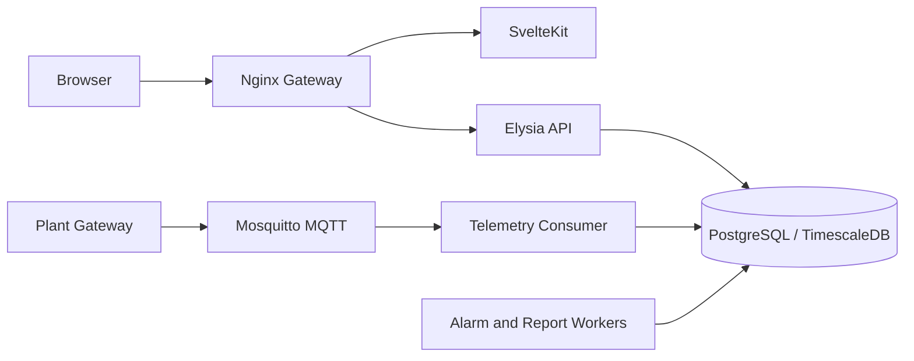

# ARD - RESS PLTS Monitoring Dashboard

## 1. Konteks dan keputusan arsitektur

Sistem memakai monorepo: SvelteKit/Svelte 5/Tailwind/ECharts untuk frontend; Bun + TypeScript + Elysia untuk API; Drizzle ORM; PostgreSQL yang siap dioptimalkan dengan TimescaleDB; Mosquitto MQTT; dan Nginx sebagai gateway.



## 2. Komponen

| Komponen               | Tanggung jawab                                              |
| ---------------------- | ----------------------------------------------------------- |
| Frontend               | Routing, dashboard, tabel, chart, filter, interaction state |
| API                    | HTTP contract, validation, authorization, orkestrasi bisnis |
| Drizzle                | Schema TypeScript, query, migration                         |
| PostgreSQL/TimescaleDB | Master data, user, telemetry, aggregate, audit              |
| MQTT                   | Telemetry dan event perangkat                               |
| Nginx                  | Public entry point, routing, TLS termination                |
| Shared types           | Kontrak response TypeScript frontend/backend                |

Repository: `apps/frontend`, `apps/backend`, `packages/shared-types`, `nginx`, dan `docker-compose.yml`.

## 3. Runtime flow

### Read flow

Browser memakai `src/lib/api/client.ts`, request masuk ke Nginx/API, Elysia memvalidasi input, Drizzle query database, lalu JSON dikembalikan ke Svelte component/ECharts.

### Telemetry target flow

Gateway publish topic MQTT; consumer memvalidasi device/metric/value/timestamp/quality, melakukan deduplication, menyimpan raw reading, membuat agregasi, kemudian alarm evaluator dan notification worker memproses event.

## 4. Data model saat ini

| Tabel             | Isi                                             |
| ----------------- | ----------------------------------------------- |
| `users`           | id, email unique, passwordHash, role, createdAt |
| `plants`          | id, name, location, capacityKw, createdAt       |
| `devices`         | id, plantId, name, type, isOnline, createdAt    |
| `sensor_readings` | id, deviceId, metric, value, timestamp          |

Relasi: plant memiliki banyak device; device memiliki banyak sensor reading.

### Model target yang perlu ditambahkan

`plant_access`, `device_metadata`, `metric_definitions`, `alarm_rules`, `alarms`, `maintenance_work_orders`, `remote_sessions`, `remote_commands`, `firmware_packages`, `firmware_deployments`, `notifications`, `audit_logs`, dan tabel aggregate time-series.

## 5. API saat ini

| Method | Endpoint                  | Fungsi                                    |
| ------ | ------------------------- | ----------------------------------------- |
| GET    | `/health`                 | Health check                              |
| GET    | `/api/devices`            | Maksimal 100 device terbaru               |
| GET    | `/api/readings?limit=100` | Reading terbaru, limit 1-1000             |
| GET    | `/api/readings/latest`    | 100 reading terbaru                       |
| POST   | `/api/ingest`             | Insert deviceId, metric, value, timestamp |

Swagger tersedia di `/swagger`. API client frontend memakai `VITE_API_BASE_URL` dengan default `http://localhost:3000`.

## 6. API target minimum

```text
POST   /api/auth/login              POST   /api/auth/logout
GET    /api/me                      GET    /api/plants
POST   /api/plants                  GET    /api/plants/:plantId
PATCH  /api/plants/:plantId         GET    /api/devices/:deviceId
POST   /api/devices                 PATCH  /api/devices/:deviceId
GET    /api/readings/history        GET    /api/alarms
POST   /api/alarms/:id/acknowledge  POST   /api/alarms/:id/resolve
GET    /api/maintenance/work-orders POST   /api/maintenance/remote-sessions
POST   /api/maintenance/remote-commands
GET    /api/reports                 POST   /api/reports/exports
GET    /api/settings                PATCH  /api/settings
```

Endpoint target wajib memiliki authentication, authorization, request ID, schema validation, pagination, dan error envelope konsisten.

## 7. MQTT contract target

```text
ress/v1/{plantId}/{deviceId}/telemetry
ress/v1/{plantId}/{deviceId}/status
ress/v1/{plantId}/{deviceId}/alarm
ress/v1/{plantId}/{deviceId}/command/ack
```

Payload telemetry minimum:

```json
{
  "messageId": "uuid",
  "deviceId": "uuid",
  "metric": "active_power_kw",
  "value": 94.82,
  "unit": "kW",
  "quality": "good",
  "timestamp": "2026-09-18T12:00:00.000Z"
}
```

Command harus memiliki correlation ID, expiry, allowlist, acknowledgement, dan audit.

## 8. Security

- TLS untuk browser, API, MQTT, dan koneksi database lintas host.
- Session cookie HttpOnly/Secure/SameSite atau token rotation yang setara.
- Argon2id atau bcrypt untuk password.
- RBAC dan plant authorization ditegakkan di server.
- Validasi UUID, enum, numeric range, timestamp, dan ukuran payload.
- Rate limit login, ingestion, export, dan remote command.
- Secret memakai environment/secret manager.
- Audit login, role, threshold, alarm, firmware, dan remote command.
- Remote command memakai allowlist, confirmation, timeout, emergency lock, dan approval risiko tinggi.

## 9. Reliability dan data integrity

- Unique key deduplication, misalnya `(device_id, metric, timestamp, message_id)`.
- Index `sensor_readings(device_id, timestamp desc)` serta index filter plant/status.
- Hypertable/time partitioning jika volume telemetry memerlukannya.
- Pisahkan raw, hourly, daily, dan monthly aggregate.
- Retry exponential backoff dan dead-letter queue untuk worker/payload invalid.
- Backup terjadwal dan restore drill.
- Tampilkan umur reading dan status stale ketika melewati freshness threshold.

## 10. Observability

Structured JSON log dengan request ID, user ID, plant ID, device ID, dan latency. Metrics minimum: API rate/error/latency, ingestion throughput, MQTT lag, stale device, alarm delivery, dan database pool. Sediakan liveness/readiness, tracing request database/worker, serta alert untuk dependency failure, error spike, ingestion lag, dan backup failure.

## 11. Deployment

Development memakai Docker Compose untuk PostgreSQL/TimescaleDB, Mosquitto, dan Nginx; backend Bun di port 3000; frontend dev server di port 5173.

Production target: frontend build artifact, backend dan worker sebagai managed service, Nginx sebagai public entry point dengan TLS, database/MQTT private, serta CI untuk typecheck, lint, test, migration check, dan build.

## 12. Frontend architecture

Route berada di `apps/frontend/src/routes`, chart reusable di `src/lib/components/Chart.svelte`, API terpusat di `src/lib/api/client.ts`, dan shared contract di `packages/shared-types`. Tahap berikutnya: server load, query state di URL, reusable table/filter, loading/empty/error state, dan permission-aware navigation.

## 13. Error contract target

```json
{
  "error": {
    "code": "DEVICE_NOT_FOUND",
    "message": "Device tidak ditemukan",
    "requestId": "uuid",
    "details": []
  }
}
```

Gunakan status `400` validation, `401` unauthenticated, `403` forbidden, `404` missing, `409` conflict, `429` rate limit, dan `5xx` dependency/server failure.

## 14. ADR ringkas

- **SvelteKit:** file-based routing, SSR/load, dan reactive component cocok untuk dashboard.
- **Bun + Elysia:** runtime TypeScript ringan dengan schema validation di API boundary.
- **PostgreSQL/TimescaleDB:** relasi bisnis dan time-series berada dalam satu platform.
- **MQTT:** cocok untuk telemetry publish-subscribe dan koneksi device intermittent.
- **Shared TypeScript contracts:** mengurangi drift, tetapi tetap memerlukan runtime validation.

## 15. Gap dan prioritas

| Gap                                               | Dampak                                   | Prioritas |
| ------------------------------------------------- | ---------------------------------------- | --------- |
| UI belum terhubung ke sebagian besar domain API   | Data produksi belum tampil nyata         | P0        |
| Auth dan authorization belum ditegakkan           | Risiko akses tidak sah                   | P0        |
| MQTT consumer belum ada                           | Telemetry nyata belum diproses           | P0        |
| Alarm, notification, audit schema belum ada       | Workflow operasi belum dapat ditelusuri  | P0        |
| Plant/device CRUD belum tersedia                  | Master data masih statis                 | P1        |
| Export, remote action, firmware masih placeholder | Fitur operasional belum production-ready | P1        |
| Observability dan backup drill belum ada          | Risiko operasional production            | P1        |

## 16. Definition of done

Semua route utama memakai API nyata atau menyatakan state demo; migration repeatable; auth/RBAC/audit/error contract diuji; ingestion menangani duplicate, invalid, delayed, out-of-order; dashboard diuji dengan dataset production-like; remote command memiliki guardrail; dan CI menghasilkan artifact deployable dengan health check lulus.
