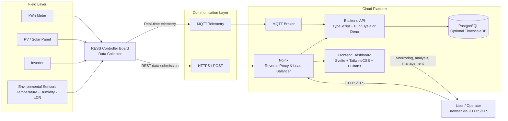
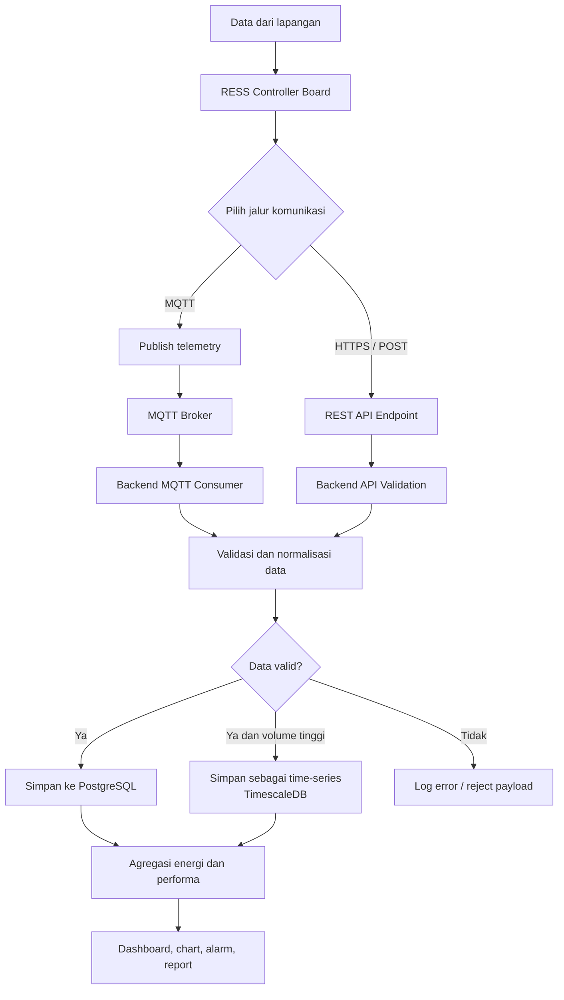
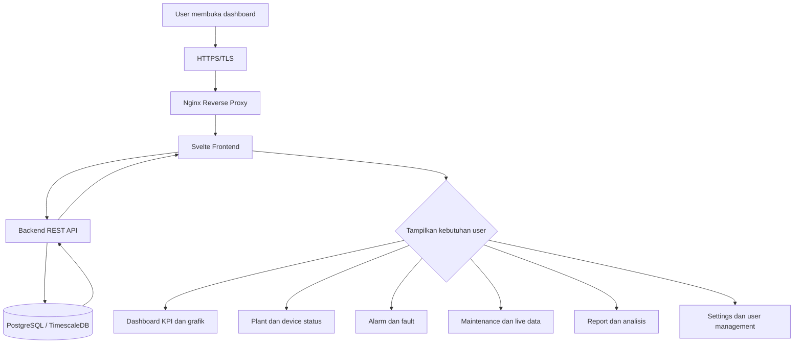
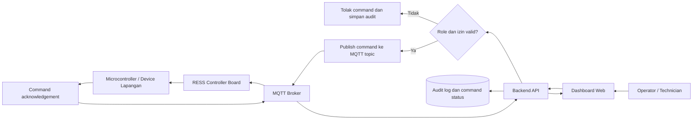
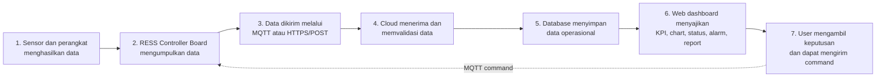

# Flowchart RESS Platform

Dokumen ini merangkum MoM arsitektur awal RESS Platform dalam format yang siap dipakai untuk presentasi. Diagram utama cukup untuk satu slide; diagram detail dapat dipakai sebagai slide lanjutan.

## 1. Flowchart Utama

## 2. Alur Data Telemetry

## 3. Alur Monitoring pada Web

## 4. Alur Command dari Cloud ke Controller

Komunikasi command masih berupa rancangan. Jalur yang dipertimbangkan adalah MQTT publish-subscribe.

## 5. Alur End-to-End untuk Slide Presentasi

## 6. Keterangan Komponen

| Komponen              | Peran dalam flowchart                                              |
| --------------------- | ------------------------------------------------------------------ |
| kWh meter             | Mengirim data konsumsi atau energi listrik                         |
| PV                    | Sumber pembangkitan energi surya                                   |
| Inverter              | Mengubah dan melaporkan energi listrik dari PV                     |
| Sensor lingkungan     | Mengirim temperatur, kelembapan, dan intensitas cahaya melalui LDR |
| RESS Controller Board | Mengumpulkan, membaca, dan meneruskan data lapangan                |
| MQTT                  | Jalur telemetry ringan dan real-time; juga kandidat jalur command  |
| HTTPS/POST            | Jalur pengiriman data melalui REST API                             |
| Nginx                 | Reverse proxy dan load balancer pada sisi cloud                    |
| Frontend              | Menampilkan dashboard monitoring yang responsif dan interaktif     |
| Backend               | Validasi, business logic, API, alarm, report, dan akses database   |
| PostgreSQL            | Penyimpanan data relasional dan operasional                        |
| TimescaleDB           | Opsi optimasi untuk data telemetry time-series berskala besar      |
| MQTT Broker           | Perantara publish-subscribe antara controller dan cloud            |

## 7. Batasan Status Rancangan

### Sudah tercermin pada repository

- Frontend SvelteKit dengan TailwindCSS dan Apache ECharts.
- Backend Bun, TypeScript, dan Elysia.
- PostgreSQL/TimescaleDB pada Docker Compose.
- MQTT broker Mosquitto pada Docker Compose.
- Nginx sebagai gateway.
- REST endpoint untuk health, device, readings, dan ingestion.

### Masih berupa rencana atau backlog

- Pemilihan final antara Bun, Elysia, atau Deno.
- MQTT consumer aplikasi dan kontrak telemetry production.
- Pengiriman command dari cloud ke controller.
- Alarm engine, notification worker, dan audit log.
- Load balancer multi-instance pada deployment production.
- Pemilihan provider VPS: BiznetGio, Hostinger, atau DigitalOcean.

## 8. Rekomendasi Susunan Slide

1. **Slide 1 - Big picture:** gunakan Flowchart Utama.
2. **Slide 2 - Data flow:** gunakan Alur Data Telemetry.
3. **Slide 3 - Web experience:** gunakan Alur Monitoring pada Web.
4. **Slide 4 - Future control:** gunakan Alur Command dari Cloud ke Controller.
5. **Slide 5 - Implementation status:** gunakan bagian Batasan Status Rancangan.

Pesan utama untuk presenter: **data dikumpulkan oleh RESS Controller Board, dikirim melalui MQTT atau HTTPS, diproses di cloud, disimpan pada database, lalu ditampilkan melalui web dashboard untuk monitoring dan pengambilan keputusan.**
